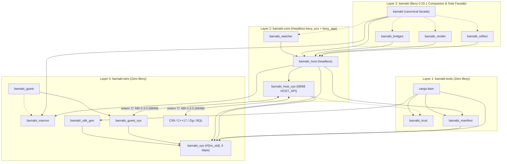
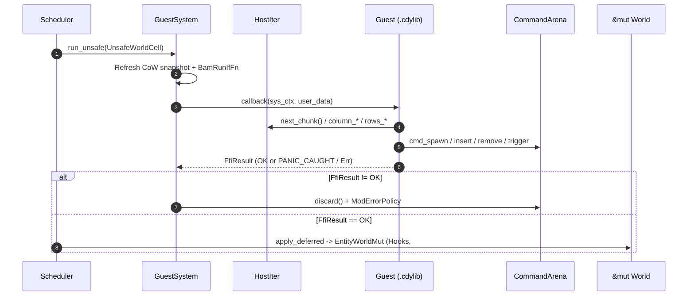

# Architecture Guide: `bamabi` (`ABI 0.3.0`)

Architecture, safety invariants, federated 5-repository topology, and subsystem internals of **`bamabi`**—a zero-serialization, asymmetric C-ABI native modding framework for Bevy ECS (`v0.20.1`). For byte-level struct layouts, field offsets, error codes, and wire rules, see [`bamabi-wire/spec.md`](https://github.com/yaga-simha/bamabi-wire/blob/main/spec.md).

## 1. Design Philosophy & Non-Negotiable Invariants

Native dynamic modding inside a parallel ECS faces four hazards: unstable Rust `.cdylib` ABIs, dual-heap allocator corruption, parallel scheduler data races, and dangling pointers after `dlclose` / `FreeLibrary`. Five strict invariants resolve them:

1. **Zero Shared Rust ABI (`ABI 0.3.0`, `0x0003_0000`):** Host and guest never share `#[repr(Rust)]` layouts, `dyn Trait`, `&[T]`/`&str`, `Vec`, `Box`, or panic unwinds across `.cdylib` boundaries. Guests may mix `rustc` versions, Debug/Release profiles, ISO C99, C++17/20, or Zig via [`bamabi-wire/include/bamabi.h`](https://github.com/yaga-simha/bamabi-wire/blob/main/include/bamabi.h) (or exported via `bamabi_sdk_gen` / `cargo bam header`).
2. **Asymmetric Zero-Copy Execution:** The host drives dynamic Bevy `System`s over contiguous Structure-of-Arrays (SoA) `Table` slices and batched `SparseSet` indirect row pointers under Bevy's `FilteredAccessSet` borrow rules.
3. **Strict Allocator Isolation:** Host allocations live/die on the host allocator; guest allocations (closures, plugins, `GuestInstance`) live/die on the guest allocator in `bamabi_shutdown`.
4. **Zero-Steady-State-Allocation Hot Paths:** Components, resources, and messages resolve once at init into 1-based `BamComponent` handles; frame loops reuse bump-allocated `CommandArena` slabs, command tapes, and scratch row buffers.
5. **Encapsulated `-sys` Unsafe Boundary & Slim Headless Host:** All `unsafe` FFI code lives in `bamabi_sys`, `bamabi_host_sys` (sealed `pub(crate)` `ffi/` + `ffi/validation.rs`), and `bamabi_guest_sys` (`#![deny(unsafe_op_in_unsafe_fn, improper_ctypes_definitions, clippy::undocumented_unsafe_blocks, clippy::missing_safety_doc)]`). All 12 safe library/CLI crates (§2, plus `xtask` in `bamabi-showcase`) enforce `#![forbid(unsafe_code)]`; `bamabi_host` has zero `bevy_render`, `bevy_reflect`, `bevy_scene`, `bevy_asset`, or `notify` deps.

> **Native Trust Model:** Native libraries execute in-process with host OS privileges and `nounwind` callbacks. `bamabi` protects cooperative/trusted mods against compiler ABI skew, ECS aliasing UB, allocator crossover, and panics (`PANIC_CAUGHT` quarantine)—it is **not** a sandbox against adversarial code (use Wasm for untrusted scripts). `signature-verification` enforces pure-Rust Ed25519 `SSHSIG`, CA cert, `.bam_sig`/`.bampack`, and authority-scoped `SSHKRL` checks **before** `dlopen` / `LoadLibraryW`.

---

## 2. Federated 5-Repository Topology & Crate Boundaries

Refactored from the original [`bevy_mod_abi`](https://github.com/yaga-simha/bevy_mod_abi) monorepo, `bamabi` is partitioned into **five strictly acyclic repositories** (Layers 0 through 4, comprising **15 library/CLI crates** plus `xtask`, examples, benchmarks, fuzzers, and the mdBook guide in [`bamabi-showcase`](https://github.com/yaga-simha/bamabi-showcase)) synchronized via `abi-lock.toml` and [`bamabi-dev-overlay/sync_check.py`](https://github.com/yaga-simha/bamabi-dev-overlay). The legacy `bevy_abi_mod` compatibility shim was removed; [`bamabi`](https://github.com/yaga-simha/bamabi) is the sole canonical host facade.



| Layer / Repo | Crate | Policy | `bevy*` Deps | Responsibilities |
|---|---|---|---|---|
| **L0 `bamabi-wire`** | `bamabi_sys` | `#![no_std]`, 0 deps | None | Wire contract (`ABI 0.3.0`), 68-slot `BamHostApi`, `offsets` (`OFF64_*`/`OFF32_*`), `ComponentUuid` (SipHash-2-4-128), `FfiResult` (`CYCLE_DETECTED`), descriptors, `ModComponent`, `AbiPod`, `RawInsertable`. |
| **L0 `bamabi-wire`** | `bamabi_macros` | `#![forbid(unsafe_code)]` | None | `#[derive(ModComponent, AbiPod, GuestComponent)]`, zero-padding checks, hygienic VTables, `SCHEMA_FINGERPRINT`, `BAM_FIELDS`, `REQUIRED_COMPONENTS`, `#[guest_component(...)]`, `#[mod_component(..., guest)]`, `C_DECL`/`ZIG_DECL`. |
| **L0 `bamabi-wire`** | `bamabi_sdk_gen` | `#![forbid(unsafe_code)]` | None | Generates `include/bamabi.h` (C99), `bamabi.hpp`, `bamabi.zig`, and component headers (`BAM_EXPORT`, `BAM_RESTRICT`, `BAM_HOST_API_OFFSET_*`). |
| **L0 `bamabi-wire`** | `bamabi_guest_sys` | Guest `unsafe` | None | `GuestInstance`, `extern "C"` panic guards (`ReentrantCell`), all 68 `BamHostApi` `covers_slot` wrappers, validated slice/row/command/resource/migration wrappers. |
| **L0 `bamabi-wire`** | `bamabi_guest` | `#![forbid(unsafe_code)]` | None | Safe Rust guest SDK (`GuestPlugin`, `GuestApp`, `#[derive(AbiPod, GuestComponent)]`, typed `query_typed`/`single_query`, 16-term `QueryTuple`, `Or<(T0..T7)>`, `ObserverBuilder::run_if`, `GuestTransaction`, `ScheduleSetBuilder`, `RelationDescBuilder`, `export_mod!`). |
| **L1 `bamabi-tools`** | `bamabi_trust` | `#![forbid(unsafe_code)]` | None | Pure-Rust Ed25519 `SSHSIG`, CA certs, authority-scoped `SSHKRL` (`DEFAULT_KRL_SIGNER_PRINCIPAL`, `add_krl_signer_*`), `.bam_sig`, and hardened `.bampack` (`VerifiedBamPack::extract_to_dir`). |
| **L1 `bamabi-tools`** | `bamabi_manifest` | `#![forbid(unsafe_code)]` | None | `mod.toml` parser, hardened ID/entry path & symlink validation (`validate_mod_id`, `validate_manifest_entry_path`), and Kahn SemVer DAG sorter. |
| **L1 `bamabi-tools`** | `cargo-bam` | `#![forbid(unsafe_code)]` | None | Standalone CLI (`new`, `export-sdk`/`header`, `build`, `pack`, `watch`, `check-mods`, `doctor`, `keygen`, `sign`, `verify`). |
| **L2 `bamabi-core`** | `bamabi_host_sys` | Host `unsafe` | `bevy_ecs`, `bevy_app`, `bevy_tasks`, opt. `bevy_reflect` | 68/68 `HOST_API`, sealed `ffi/` + `ffi/validation.rs` (panic-free `BamFieldReflectSlot` pool), `HostIter`, `CascadeHierarchyCache`, `CommandArena`, `ModRelationGraph`, `ModScheduleSetRegistry`, `BamSymbolTable`, `ModNamedObjects`, `GuestSystem`, observer `FallbackErrorHandler`/`ErrorContext::Observer`, `ModRegistry`, `ModHost`, `LoadedMod::registered_schedule_labels`, checked-arithmetic binary parsers, `DROP_PAGES`, non-`keygen` `bamabi_trust` parity. |
| **L2 `bamabi-core`** | `bamabi_host` | `#![forbid(unsafe_code)]` | `bevy_ecs`, `bevy_app`, opt. `bevy_diagnostic` (**headless**) | Slim headless `AbiModPlugin`, `ModLifecycleFlush`, `ModBudgetPolicy`/`ModBudgetTelemetry`, `ModAppExt`, `ModWorldExt` (`ScheduleLeased` guards, skip-leased `unload_all_mods`, `despawn_all_where` incl. `Allow<Disabled>`, `ComponentOptions::with_summary_tick()`), `ModCommandsExt` (safe-point deferral), `ModDagErrorKind` + 13 accessors, `ModVisibleSets`, `ModUnloadHooks`. |
| **L2 `bamabi-core`** | `bamabi_watcher` | `#![forbid(unsafe_code)]` | `bevy_app`, `bevy_ecs`, `notify-debouncer-full` | Debounced recursive filesystem watcher (`ModHotReloadPlugin`, `ModHotReloadWatcher`, `ModHotReloadHistory`) polling in `ModLifecycleFlush`, synchronous `with_sync_on_start`, transient `ScheduleLeased` retries, disconnect handling, and cascading SemVer DAG reloads. |
| **L3 `bamabi`** | `bamabi_bridges` | `#![forbid(unsafe_code)]` | Opt-in (`default = []`) | 12 granular Bevy `0.20.1` bridges (`std_types`+`Disabled`, `state`, `asset`+overlay, `bsn`, `picking`+`Gamepad`, `camera-2d`, `light`/`PanOrbitCamera`/`SolariLighting`, `audio`, `ui`+real `feathers` BSN) + 4 presets (`preset-2d`/`3d`/`ui`/`full`). |
| **L3 `bamabi`** | `bamabi_render` | `#![forbid(unsafe_code)]` | `bevy_extract`, `bevy_render`, `bevy_sprite_render`, `bevy_pbr` | `ModSubAppPlugin<L>`, `ModWeslMaterialPlugin`, `ModSpriteMaterialPlugin`, opt-in `ModMeshShaderPlugin`, and `ModRenderRecoveryPlugin` (`DeviceLost` recovery). |
| **L3 `bamabi`** | `bamabi_reflect` | `#![forbid(unsafe_code)]` | `bevy_reflect`, `bevy_remote`, `bevy-settings` | `ModReflectPlugin` (`ReflectFromPtr`/BRP/TOML), `ModSaveGamePlugin` (`HandleSerializeProcessor`/`HandleDeserializeProcessor`), and `ModTelemetryPlugin` (`bam/*` BRP + 64B digest stream). |
| **L3 `bamabi`** | `bamabi` | `#![forbid(unsafe_code)]` | Via `host` + 18 features + 4 presets | **Sole canonical host facade** re-exporting `bamabi_host`, derives, `bamabi_sys`, companion crates, curated presets, and unified `prelude`. |
| **L4 `bamabi-showcase`** | `xtask`, `examples/01..10`, `benches/`, `fuzz/`, `tests/` | `#![forbid(unsafe_code)]` (`xtask`) | Full Bevy `0.20.1` | Runnable examples, Criterion/soak benchmarks (`docs/BENCHMARKS.md`), LibFuzzer targets, integration tests, mdBook guide (`docs/book/`), and workspace automation. |

---

## 3. Extensible Wire Contract, Polyglot SDK & `bevy_bql` Lowering

### 3.1 `struct_size` Prefix Extensibility & 68/68 Live `BamHostApi`
Every extensible wire struct (`BamManifest`, `BamHostApi`, `BamSystemDesc`, `BamObserverDesc`, `BamTriggerDesc`, `BamQueryDesc`, `BamTermDesc`, `ComponentDesc`, `BamFieldDesc`, `BamRequiredComponent`, `BamRelationDesc`, `BamLayoutInfo`, `BamScheduleSetDesc`, `BamColumnInfo`, `VTableHeader`) obeys four rules:
- **`struct_size: u32` at offset `0`:** Frozen `MIN_V0_2_SIZE` / `MIN_V0_3_SIZE` are verified via `core::mem::offset_of!`. `BamHostApi` has `MIN_V0_2_SIZE = 224` B (64-bit) / `116` B (32-bit) and `MIN_V0_3_SIZE = size_of = 552` B (64-bit) / `280` B (32-bit). All **68/68** slots (`27` core v0.2, `23` extended v0.2, and all `18` ABI `0.3.0` slots covering diagnostics/faults, UUID/layout lookup, relations, symbols/named objects, `iter_count`/`iter_up_cascade`/`par_for_each_chunk_readonly`, decoupled schedule sets, checkpoints/rollback, and `migrate_component_column`) are 100% live.
- **Prefix Compatibility:** `read_extensible_struct` / `read_descriptor` (and C99 `bam_host_api_copy_bounded`) check `struct_size >= MIN_V0_2_SIZE`, zero-extend omitted trailing fields, and ignore unknown trailing bytes.
- **Zero Implicit Padding & Niche Callbacks:** `reserved0: u32 = 0`; unknown `flags` return `FfiResult::UNSUPPORTED`. All 68 slots use `Option<unsafe extern "C" fn(...)>`; strings use `StrView`.
- **Handle Poisoning & Tree Borrows:** Opaque handles (`BamHostCtx`, `BamLoadCtx`, `BamSystemCtx`, `BamIter`, `BamCommands`) begin with `HandleHeader { magic, generation }`, poisoned with `POISONED_MAGIC` on drop for deterministic post-scope errors in debug/`strict-ffi-checks`. `HostContext::snapshot` uses `UnsafeCell` for strict Miri Tree Borrows soundness across FFI pointers.

### 3.2 Polyglot Headers & `bevy_bql` Lowering
`bamabi_sys::offsets` exports target-native (`<FIELD>`), 64-bit (`OFF64_*`, `SIZE_64 = 552`), and 32-bit (`OFF32_*`, `SIZE_32 = 280`) offsets (`SLOT_COUNT = 68`). `bamabi_sdk_gen` emits `bamabi.h` ([`bamabi-wire/include/bamabi.h`](https://github.com/yaga-simha/bamabi-wire/blob/main/include/bamabi.h)), `bamabi.hpp`, and `bamabi.zig` with `BAM_EXPORT`, `BAM_RESTRICT` (`__restrict`/MSVC, `restrict`/C99, `"noalias"`/Zig), `BAM_HOST_API_OFFSET_*`, `BAM_STATIC_ASSERT` layout checks, and `bam_uuid_from_parts` (`SipHash-2-4-128`).

External DSL/query compilers (`bevy_bql` / `bql_jit`) lower directly onto ABI `0.3.0`:
- **Offsets & Disjoint Vectorization:** `offsets` + `BAM_RESTRICT` yield non-aliasing SoA column pointers without hardcoded slot indices.
- **Zero-Copy Reload, Migration & Reflection:** `ComponentUuid::from_parts`, unchanged `SCHEMA_FINGERPRINT` retention (`RetainedZeroCopyColumn`, `0` bytes copied), contiguous `migrate_component_column` (`OwnedMigrationBuffer`, `0` per-entity heap allocations, atomic error abort), and declarative `BamFieldDesc` reflection (`ffi/validation.rs` `BamFieldReflectSlot` pool with panic-free `slot_core`/`slot_type_info` and `UninitializedBamFieldReflectSlot` fallback -> `ReflectFromPtr`/BRP without witness VTables).
- **Random Access, Cascades & Parallelism:** $O(1)$ `sys_entity_get`/`sys_entity_get_mut`, lazy `CascadeHierarchyCache` (`iter_up_cascade` with `Tick`/`summary_tick`/`RemovedComponents` invalidation + Brent cycle guard), and zero-arena `par_for_each_chunk_readonly` (rejects writable terms with `PERMISSION_DENIED`).
- **Relations, Symbols, Transactions & Hot-Rewire:** `ModRelationGraph`, lock-free paged `BamSymbolTable`, reload-persistent `ModNamedObjects`, LIFO `cmd_checkpoint`/`cmd_rollback`, and `ModScheduleSetRegistry`/`ModScheduleSetRewirePass` (`.chain()`, `.chain_weak()`, `PARALLEL`, `BEFORE_WEAK`/`AFTER_WEAK`). Verified by [`bamabi-showcase/examples/09_bql_wire_parity`](https://github.com/yaga-simha/bamabi-showcase/tree/main/examples/09_bql_wire_parity) (`tests/bql_wire_contract_test.rs`: 500-frame bit-identical C99 vs. Safe Rust parity + live frame-250 v1→v2 migration).

---

## 4. Type System, VTables & Handle Resolution (`bamabi_macros`)

- **`#[derive(AbiPod)]`:** Enforces `#[repr(C)]`/`#[repr(transparent)]` (non-packed), `Copy + Send + Sync + 'static`, `!needs_drop::<Self>()`, compile-time zero-padding (`size_of::<Self>() == sum(size_of::<FieldTy>())`, matching `bytemuck::NoUninit`), and recursive `assert_abi_pod`. Rejects `bool`, `char`, `u128`/`i128`, `usize`/`isize`, Rust enums, references, and heap types.
- **`#[derive(GuestComponent)]`:** Zero-boilerplate guest derive (`#[guest_component(name = "...", sparse_set, immutable, summary_tick)]`) emitting only `impl GuestComponent` with zero VTable/C-decl overhead alongside `#[derive(AbiPod, GuestComponent)]` (plus `#[mod_component(name = "...", guest)]` shorthand when sharing a `ModComponent`).
- **`#[derive(ModComponent)]`:** Supports POD and opaque `#[repr(Rust)]` types (`String`, `Vec<T>`, `bool`, `#[mod_field(skip)]`): emits FNV-1a `SCHEMA_FINGERPRINT`, `BAM_FIELDS`, `REQUIRED_COMPONENTS`, `C_DECL`/`ZIG_DECL`, and a `VTableHeader`-prefixed `<Struct>VTable` (`"bam.v0.<canonical_name>.*"`). String/Vec setters copy `StrView`/`FfiSlice<T>` into temporary host buffers before mutating in place, eliminating `src`/`dst` aliasing UB. Concrete type assertions reject spoofed `String`/`Vec` types (overridable via `#[mod_field(...)]`).
- **UUIDs & CoW `ModRegistry`:** Canonical names (`"<ns>::<Name>"`) + layout + per-field `(name, tag, offset_of!)` feed a `const fn` SipHash-2-4-128 `ComponentUuid`. Guests resolve 1-based `BamComponent(u32)` handles once at init (`BamComponent(1)` = `ChildOf`). `ModRegistry` publishes a generation-tracked CoW `Arc<RegistrySnapshot>` (`foldhash`) for wait-free $O(1)$ array lookup on frame hot paths.

---

## 5. Execution, Bevy `0.20.1` Scheduler & `CommandArena`

`GuestSystem` implements Bevy's `System<In = (), Out = ()>` (`Send + Sync`):
- **`FilteredAccessSet` & Parallelism:** `build_query_groups_in_world` compiles up to `8` queries (`<= 32` terms each: `Allow<T>`, `Has<T>`, `RemovedComponents<T>`, `Or<(T0..T7)>`), resources, and `Messages<M>` into Bevy's `FilteredAccessSet`. Writes to `IMMUTABLE` components return `PERMISSION_DENIED`; intra-system conflicts fail with `SystemInitError`; disjoint systems run in parallel on `ComputeTaskPool`.
- **Schedules & Ordering:** Built-in schedules (`STARTUP`..`LAST`) and `ScheduleId::custom(id >= 1024)` map via `ModScheduleMap`. Systems join `ModSystemSet::Mod(id)` and `ModNamedSystemSet`, resolving intra-mod, cross-mod (`"other::step"`), and host sets (`app.register_mod_visible_set` -> `"host::<name>"`). `BAM_SYSTEM_FLAG_MAIN_THREAD` adds `SystemStateFlags::NON_SEND`; late `STARTUP` systems run once on commit when `StartupCompleted` exists.



- **Zero-Copy Iteration & `summary_tick`:** `HostIter` walks `matched_tables()` (or `matched_archetypes()` for `SparseSet`), skipping clean tables in $O(1)$ when `BAM_COMPONENT_FLAG_SUMMARY_TICK` is set (host `ComponentOptions::with_summary_tick()`, validated against `StorageType::Table`). `iter_column_mutable_untracked` + `iter_mark_changed_range` support selective dirtying; `GuestRes`/`GuestResMut` expose `BamChangeTicks` via `Tick::is_newer_than`.
- **`EntityWorldMut` Commands, Relations & `despawn_all_where`:** `CommandArena` reserves entities via `Entities::reserve_entity()`, writes 64-byte-aligned `MaybeUninit<u8>` slabs (`ptr::copy_nonoverlapping`), supports LIFO `cmd_checkpoint`/`cmd_rollback`, and applies via `EntityWorldMut` (`spawn_empty_at`, `insert_by_ids`, `remove_by_id`, `despawn`, `trigger`) preserving `ComponentHooks`, `#[require(...)]`, `ChildOf`/`Children`, and `ModRelationGraph`. Non-acyclic relations allow opt-in self-referential edges (`allows_self_referential()`; acyclic/default reject self-loops). Teardown uses Bevy `0.20.1`'s `world.despawn_all_where::<_, (Allow<Disabled>, ...)>` so `Disabled` mod-scoped and `LoadedModInfo` entities are cleaned up without touching `IsResource` entities.
- **Budgets (`ModBudgetPolicy`):** Enforces per-mod `CommandArena` byte caps (`CAPACITY_EXCEEDED` + `ArenaWatermark` rewind), atomic per-frame spawn quotas, and sliding-window `p50_us`/`p99_us` watchdogs emitting `Messages<ModBudgetBreach>` with auto-quarantine.

---

## 6. Buffered `Messages<M>`, Triggers & Dynamic Observers

- **Buffered `Messages<M>`:** POD (`register_mod_message`) and VTable non-POD (`register_mod_non_pod_message`) streams maintain per-system `MessageCursor<M>` persisted across reloads (`PersistentMessageCursors`).
- **Triggers & Observers:** Host `Event`/`EntityEvent` types and dynamic guest events trigger via `BamObserverDesc`/`BamTriggerDesc` (`ADD`, `INSERT`, `DISCARD`, `REMOVE`, `DESPAWN`, `READY`), mutable `BamObserverMutFn` payloads, and stoppable upward `ChildOf`/custom-relation propagation. `ObserverBuilder::run_if`/`run_if_fn` compose short-circuit predicates on the guest. Observer faults discard uncommitted commands and route to Bevy `0.20.1`'s `FallbackErrorHandler` with `ErrorContext::Observer`.

---

## 7. Runtime Dynamic Components & `DROP_PAGES` Reclamation

Guest dynamic components (`register_component`) attach foreign `drop_fn`s, `clone_fn`s, transitive `required_components`, and all five Bevy `0.20` lifecycle hooks (`DynamicComponentHookMap`). Because foreign `drop_fn`s live in `.cdylib` `.text`, two teardown races exist: unloading a mod while entities survive, and dropping `World` in arbitrary table vs. resource order.

```mermaid
stateDiagram-v2
    [*] --> FREE: Lazy DROP_PAGES (64x64 = 4,096 slots)
    FREE --> IN_USE: alloc slot (IN_USE | 0) + WorldDropGuard(slot, gen)
    IN_USE --> IN_USE: on_insert: +1; drop: run if active & -1; unload: is_active=false
    IN_USE --> CLOSING: WorldDropGuard::drop -> fetch_xor(IN_USE | CLOSING)
    CLOSING --> CLOSING: entity drop skips unmapped drop_fn & -1
    CLOSING --> FREE: prev == CLOSING|1 or live == 0 -> CAS(0), bump gen
```

Pre-monomorphized `drop_trampoline::<SLOT>` (`fn(OwningPtr<'_>)`) functions back `DROP_PAGES: [OnceLock<Box<DropPage>>; 64]` with wait-free `ArcSwapOption<DropSlotSnapshot>` reads. Packing `(state_bits | live_values)` into one `AtomicUsize` puts `WorldDropGuard::drop` (`fetch_xor`) and `drop_trampoline` (`fetch_sub`) in one modification order—exhaustively verified across 3 models under Loom (`loom_drop_trampoline`, including `loom_slot_reuse_aba_stale_reader_never_invokes_new_generation_drop` proving recycled generation isolation against stale readers) for zero use-after-`dlclose`. Unloaded dynamic `ComponentId`s stay registered (`vtable_ptr` cleared) so reloads rebind destructors and hooks cleanly.

---

## 8. Lifecycle, Safe-Point Scheduling, Security & Fault Containment

- **Transactional Load, Checked Parsers & Shadow Copying:** `LoadOptions::shadow_copy` copies `<stem>.<ext>` to `<stem>.<pid>.<seq>.<ext>` before `dlopen`/`LoadLibraryW` (avoiding POSIX inode caching, Windows `.dll`/`.pdb` locks, and Apple Silicon code-sign `SIGKILL`s; `Library` drops strictly before unlinking). ELF32/ELF64, Mach-O thin/fat, and PE32/PE32+ residency & CodeView RSDS parsers (`shared_lib.rs`) use checked arithmetic (`checked_add`/`checked_mul`/`usize::try_from`) and bounded slicing (fuzzed via `proptest` in `shared_lib_tests.rs`). Init or strict-validation failures trigger `LoadTransaction::drop` rollback (tombstone `DROP_PAGES`, restore `RegistrySnapshot`, despawn observers, unmap).
- **`ModLifecycleFlush` & Leased-Schedule Contract (`ScheduleLeased`):**
  - `ensure_mod_lifecycle_flush_schedule(app)` initializes `ModLifecycleFlush` and inserts it immediately after `Last` in `MainScheduleOrder` (or appends it if `Last` is absent), installing `flush_pending_mod_lifecycle_ops`. Because mods cannot target `ModLifecycleFlush` via `ScheduleId`, only `Main` and `ModLifecycleFlush` are leased while it runs.
  - `leased_schedules(world)` inspects `Schedules::get_temporarily_removed()`, and `LoadedMod::registered_schedule_labels()` yields every `InternedScheduleLabel` in which a mod registered systems or named sets.
  - **`ModCommandsExt` deferral rule:** Deferred ops execute immediately only when `leased ⊆ {ModLifecycleFlush, Main}` and `(ModLifecycleFlush ∈ leased || Main ∉ leased)`; otherwise they queue into `PendingModLifecycleOps` and drain FIFO in `ModLifecycleFlush` (re-queueing remaining ops if a running op leases another schedule mid-flush).
  - **Direct `ModWorldExt` guards (`ModLoadError::ScheduleLeased`):** Direct `load_mod*` (`prevalidate_mod_schedules_and_ordering`), `unload_mod` / `reload_mod*` (`ensure_cascade_schedules_not_leased` & `excise_and_unload_mod_inner`), and schedule-mutation helpers reject or skip leased schedules deterministically. `unload_all_mods()` warns via `tracing::warn!` and skips mods whose cascade targets a leased schedule so `ModHost` may remain non-empty while unaffected mods unload cleanly.
- **Deterministic 5-Step Unload (`&mut World` / `Commands`):** Exclusive `World` access prevents concurrent `dlclose` at compile time: (1) excise `ModSystemSet::Mod(id)` (after verifying `registered_schedule_labels()` are unleased); (2) tombstone `DROP_PAGES`/`DynamicComponentHookMap`, despawn observers, run `ModUnloadHooks`, and `despawn_all_where` mod-scoped entities (incl. `Disabled`); (3) null VTables & purge `bam.v0.*` symbols; (4) invoke `bamabi_shutdown(instance)`; (5) `dlclose`, unlink shadow copy, emit `ModUnloaded`. Hot reload (`reload_mod`) brackets unload/load with `save_state`/`restore_state`, retaining unchanged `SCHEMA_FINGERPRINT` columns with `0` bytes copied.
- **SemVer DAG Diagnostics (`ModDagErrorKind` & Accessors):** `mod_dag.rs` exposes `ModDagErrorKind` (`as_str() -> &'static str`) and 13 structured accessors on `ModDagError` (`kind`, `path`, `related_paths`, `mod_name`, `dependency`, `required_version`, `found_version`, `cycle_members`, `load_error`, `mod_id`, `is_cycle`, `is_io`, `is_recoverable`).
- **Cryptographic Trust (`signature-verification` / `bamabi_trust` & `bamabi_manifest`):**
  - Pure-Rust `#![forbid(unsafe_code)]` verification runs **before** `dlopen`/`LoadLibraryW` (blocking malicious static constructors/`DllMain`), using `ed25519_dalek::VerifyingKey::verify_strict` (rejecting empty inputs/nonces, torsion points, non-canonical coordinates, and malleable scalars).
  - Supports detached `.sig` (`SSHSIG`), embedded `.bam_sig` (ELF/Mach-O/PE), Ed25519 CA certs with validity/principal checks, `PROTOCOL.krl` (`SSHKRL`) & signed KRLs with `with_min_krl_version` anti-rollback + KRL signer authority scoping (`DEFAULT_KRL_SIGNER_PRINCIPAL = "krl-signer"`, `add_krl_signer_openssh`, `add_krl_signer_file`, `with_krl_signer_principal`), and hardened `.bampack` verification/extraction (`verify_bampack_bytes`, `verify_bampack_file`, `VerifiedBamPack::extract_to_dir` / `extract_to_dir_with_limits` enforcing entry/depth/byte bounds and rejecting traversal/symlinks).
  - `bamabi_host_sys::loader::signing` (and `bamabi_host`) expose 100% parity with all non-`keygen` `bamabi_trust` items (`Deref` getters on `ModTrustPolicy`, `bampack`, `embedded_sig`, `ssh_key`, `LineEnding`, `Algorithm`, `Certificate`, `Fingerprint`, `HashAlg`, `PrivateKey`, `PublicKey`, `BamPackExtractLimits`, `BamPackExtractError`, etc.). **Note:** `bamabi_trust::keygen` items remain upstream-gated because `bamabi_trust/keygen` (`ssh-key/getrandom`) is not enabled by `signature-verification` in `crates/bamabi_host_sys/Cargo.toml`.
  - TOCTOU defense writes verified bytes once into a `create_new(true)` (`0o700` Unix / `FILE_SHARE_READ` Windows) file in a verified non-symlink, non-world-writable shadow dir. `bamabi_manifest` rejects invalid IDs, traversal, and symlinks (`validate_mod_id`, `validate_manifest_entry_path`).
  - Hot reloads run `preverify_mod_on_disk` + principal checks before unloading; loaded mods carry `VerifiedModSignature` (with owned and `&` `From` conversions); `evict_revoked_mods()` unloads newly revoked mods live.
- **Fault Policy (`ModErrorPolicy`):** Default `panic = "unwind"` Rust guests catch unwinds in `ReentrantCell` trampolines, drop payloads on the guest heap, and return `PANIC_CAUGHT`. On non-`OK`, the host discards uncommitted commands, emits `ModSystemFaulted`, and applies `Quarantine` *(default; `ModQuarantine::reenable`)*, `Log`, `ReportToBevy`, or `DelegateToBevyFallback` (`FallbackErrorHandler`).

---

## 9. Companion Crates & Bevy `0.20.1` Subsystems

All four companion crates enforce `#![forbid(unsafe_code)]`, register teardown with `ModUnloadHooks`, and re-export through **`bamabi`**:
- **Bridges & Presets (`bamabi_bridges`):** 12 granular features (`default = []`), incl. lightweight `bridge-camera-2d` (no `bevy_pbr`/`bevy_light`) and `bridge-feathers` (real `bevy_feathers` BSN hydration), plus 4 presets: `preset-2d` (`ModPreset2dPlugin`), `preset-3d` (`ModPreset3dPlugin`), `preset-ui` (`ModPresetUiPlugin`), and `preset-full` (`ModPresetFullPlugin`).
- **Render & Recovery (`bamabi_render`, `sub-app-extract`):** `ModSubAppPlugin<L>`, `.wesl` `ShaderBuffer`/2D/3D material plugins, opt-in `ModMeshShaderPlugin`, and `ModRenderRecoveryPlugin` (`RenderErrorHandler` + `RenderErrorPolicy::Recover` on `ErrorType::DeviceLost`, `RenderStartup` pipeline/material reset, `ModRenderRecoveryHooks`).
- **Reflect, Savegame & Telemetry (`bamabi_reflect`, `bridge-reflect`):** `ModReflectPlugin` (witness + `BamFieldDesc` `ReflectFromPtr`, BRP, `bevy-settings` TOML), `ModSaveGamePlugin` (`StrictRequireMods`/`StripMissingModComponents`/`MigrateOnLoad` + Bevy `0.20.1` `HandleSerializeProcessor`/`HandleDeserializeProcessor` & `EphemeralHandleBehavior`), and `ModTelemetryPlugin` (`bam/*` BRP + 64B Unix/loopback digest stream).
- **Watcher (`bamabi_watcher`, `hot-reload-watcher`):** `ModHotReloadPlugin` debounced watcher polling in `ModLifecycleFlush` (`ensure_mod_lifecycle_flush_schedule`), synchronous `with_sync_on_start` initial `sync_dir` execution in `Plugin::build`, transient `ScheduleLeased` retries, `TryRecvError::Disconnected` once-logged/once-recorded outcome handling, 2s `sync_fingerprints` echo suppression, and cascading SemVer DAG reloads.

---

## 10. Contributor Verification & Federated CI Workflow

### Standalone Verification Inside `bamabi-core` (Layer 2)

```bash
# Headless isolation, formatting, clippy, rustdoc, tests, benchmarks, coverage (>= 85%), Loom, and Miri
cargo fmt --all -- --check
cargo clippy --workspace --all-targets -- -D warnings
cargo clippy -p bamabi_host_sys -p bamabi_host --features signature-verification --all-targets -- -D warnings
cargo clippy --workspace --all-targets --all-features -- -D warnings
RUSTDOCFLAGS="-D warnings" cargo doc --workspace --no-deps --all-features
cargo tree -p bamabi_host --all-features | grep -E "bevy_render|bevy_reflect|bevy_scene|bevy_asset|notify"
cargo test --workspace --all-features
cargo test --doc --all-features
cargo bench -p bamabi_host --bench chunk_throughput -- --test
cargo bench -p bamabi_host --bench v03_subsystem_bench -- --test
cargo test -p bamabi_host_sys --test loom_drop_trampoline --release
cargo llvm-cov --no-report --all-features -p bamabi_host_sys -p bamabi_host -p bamabi_watcher
cargo llvm-cov report --ignore-filename-regex '(crates/bamabi_watcher/|(tests|examples|xtask|benches)/|\.cargo/)' --fail-under-lines 85
MIRIFLAGS="-Zmiri-tree-borrows" cargo +nightly miri test -p bamabi_host_sys --lib
```

### Crate & Verification Documentation Index

| Scope | README | Architecture | Tests & Benchmarks | Agent Guide |
|---|---|---|---|---|
| **Workspace** | [`README.md`](../README.md) | `docs/ARCHITECTURE.md` | [`TESTS.md`](../TESTS.md) | [`GEMINI.md`](../GEMINI.md) |
| **`bamabi_host_sys`** | [`README.md`](../crates/bamabi_host_sys/README.md) | [`ARCHITECTURE.md`](../crates/bamabi_host_sys/ARCHITECTURE.md) | [`TESTS.md`](../crates/bamabi_host_sys/TESTS.md) | [`GEMINI.md`](../crates/bamabi_host_sys/GEMINI.md) |
| **`bamabi_host`** | [`README.md`](../crates/bamabi_host/README.md) | [`ARCHITECTURE.md`](../crates/bamabi_host/ARCHITECTURE.md) | [`TESTS.md`](../crates/bamabi_host/TESTS.md) | [`GEMINI.md`](../crates/bamabi_host/GEMINI.md) |
| **`bamabi_watcher`** | [`README.md`](../crates/bamabi_watcher/README.md) | [`ARCHITECTURE.md`](../crates/bamabi_watcher/ARCHITECTURE.md) | [`TESTS.md`](../crates/bamabi_watcher/TESTS.md) | [`GEMINI.md`](../crates/bamabi_watcher/GEMINI.md) |

### Multi-Repo Federated Overlay & Per-Layer Verification

When developing across multiple sibling repositories under a shared parent checkout, manage local `[patch]` overrides via [`bamabi-dev-overlay`](https://github.com/yaga-simha/bamabi-dev-overlay):

```bash
# Cross-repo ABI, version, license & standalone GitHub URL verification
python3 bamabi-dev-overlay/sync_check.py --strict-git
python3 bamabi-dev-overlay/overlay.py enable
python3 bamabi-dev-overlay/overlay.py status --strict
# ...run local cross-repo tests, then disable before committing lockfiles:
python3 bamabi-dev-overlay/overlay.py disable

# Layer 0 (bamabi-wire): zero-Bevy check, tests, and standalone C99 header test
(cd bamabi-wire && cargo tree --workspace | sed 's/ (.*//' | grep -v bamabi | grep -i bevy)
(cd bamabi-wire && cargo test --workspace --all-features && cargo clippy --workspace --all-targets --all-features -- -D warnings)
(cd bamabi-wire && cc -std=c99 -Wall -Wextra -Werror -I include tests/standalone_c_test.c -o /tmp/standalone_c_test && /tmp/standalone_c_test)

# Layer 1 (bamabi-tools): zero-Bevy check and trust/manifest/CLI tests
(cd bamabi-tools && cargo tree --workspace | sed 's/ (.*//' | grep -v bamabi | grep -i bevy)
(cd bamabi-tools && cargo test --workspace --all-features && cargo clippy --workspace --all-targets --all-features -- -D warnings)

# Layer 2 (bamabi-core): headless isolation, host tests, and Loom DROP_PAGES verification
(cd bamabi-core && cargo tree -p bamabi_host --all-features | grep -E "bevy_render|bevy_reflect|bevy_scene|bevy_asset|notify")
(cd bamabi-core && cargo test --workspace --all-features && cargo test -p bamabi_host_sys --test loom_drop_trampoline --release)

# Layer 3 (bamabi): facade & Bevy 0.20.1 companion bridge/render/reflect tests
(cd bamabi && cargo test --workspace --all-features && cargo clippy --workspace --all-targets --all-features -- -D warnings)

# Layer 4 (bamabi-showcase): fixtures, E2E, BQL parity, fuzz/soak, Miri, & mdBook (xtask lives here)
(cd bamabi-showcase && cargo xtask fixtures --all && cargo xtask ci)
(cd bamabi-showcase && MIRIFLAGS="-Zmiri-tree-borrows" cargo xtask miri --all)
(cd bamabi-showcase && typos && mdbook build docs/book)
```
